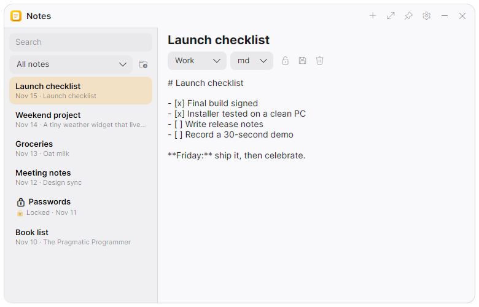
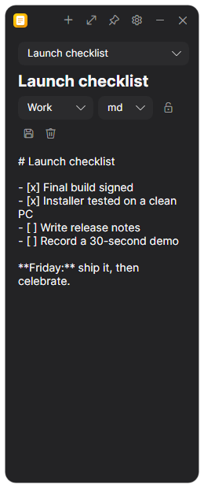

<p align="center">
  
</p>

<h1 align="center">Notes</h1>

<p align="center">
  A fast, quiet note-taking app for Windows. Press a hotkey, type, done.<br />
  Your notes stay plain files on your own PC, in whatever window shape suits your screen.
</p>

<p align="center">
  
  &nbsp;
  
</p>

## Why Notes?

Most note apps want an account, a sync service and a minute of your time. Notes just opens a small box when you
press `Ctrl` + `Alt` + `N`. Then it gets out of the way again. Every note is a normal file in a normal folder, so you
can open, back up or sync your notes with any tool you like.

## Features

- **Instant capture:** a global hotkey opens a fresh note from anywhere. Notes save automatically as you type.
  You can change the hotkey in Settings.
- **Any shape you like:** drag any edge or corner. Notes works as a thin strip down the side of your screen,
  a wide bar along the top, a normal window, or full screen. The layout adapts to fit. One-click presets are built in.
- **Plain files:** save notes as Markdown, plain text, HTML, JSON, CSV or log files. They live in
  `Documents\Notes`, and you can choose a different folder.
- **Categories:** sort notes into categories, then filter and search across all of them.
- **Password protection:** lock any note with a password. It's encrypted with AES-256-GCM, using a key derived
  with PBKDF2-SHA256 (310,000 iterations).
- **Your colors:** light and dark modes, accent presets or any hex color, custom background and text colors,
  window opacity, font and text size.
- **Small comforts:** keep the window on top, see notes in the system tray, and restore deleted notes from the Recycle Bin.

## Install

1. Download **`NotesSetup.exe`** from the [latest release](../../releases/latest).
2. Run it. No admin rights are needed, and .NET doesn't need to be installed.
3. Type "Notes" in the Start menu, or press `Ctrl` + `Alt` + `N`.

Setup can start Notes with Windows. To uninstall, use **Settings → Apps**. Your notes and settings are kept.

> Windows SmartScreen may warn you about the installer because it isn't code-signed.
> Click **More info → Run anyway**.

## Keyboard shortcuts

| Shortcut | Action |
| --- | --- |
| `Ctrl` + `Alt` + `N` | Show Notes with a new note, from anywhere (you can change this) |
| `Ctrl` + `N` | New note |
| `Ctrl` + `S` | Save now |
| `Ctrl` + `L` | Lock the open protected note |
| `Esc` | Hide the window |

Double-click the title bar to switch between a slim strip and a normal window.

## Where your data lives

| What | Where |
| --- | --- |
| Notes | `Documents\Notes\<Category>\<Title>.<format>` (you can change this in Settings) |
| Protected notes | Same place, with an extra `.locked` extension. If you forget the password, the note can't be recovered |
| Settings | `%APPDATA%\Notes\settings.json` |

## Build from source

You need the [.NET 10 SDK](https://dotnet.microsoft.com/download).

```powershell
dotnet run -c Release --project src/Notes                          # run the app
powershell -ExecutionPolicy Bypass -File scripts/build-installer.ps1   # build dist\NotesSetup.exe
powershell -ExecutionPolicy Bypass -File scripts/screenshots.ps1       # regenerate the README screenshots
```

```
src/Notes/       the app: Avalonia UI, storage, encryption, themes
src/Installer/   NotesSetup.exe, a per-user installer and uninstaller
scripts/         build and screenshot scripts
docs/            README screenshots
```

Built with [Avalonia UI](https://avaloniaui.net/) and the [Inter](https://rsms.me/inter/) typeface.
